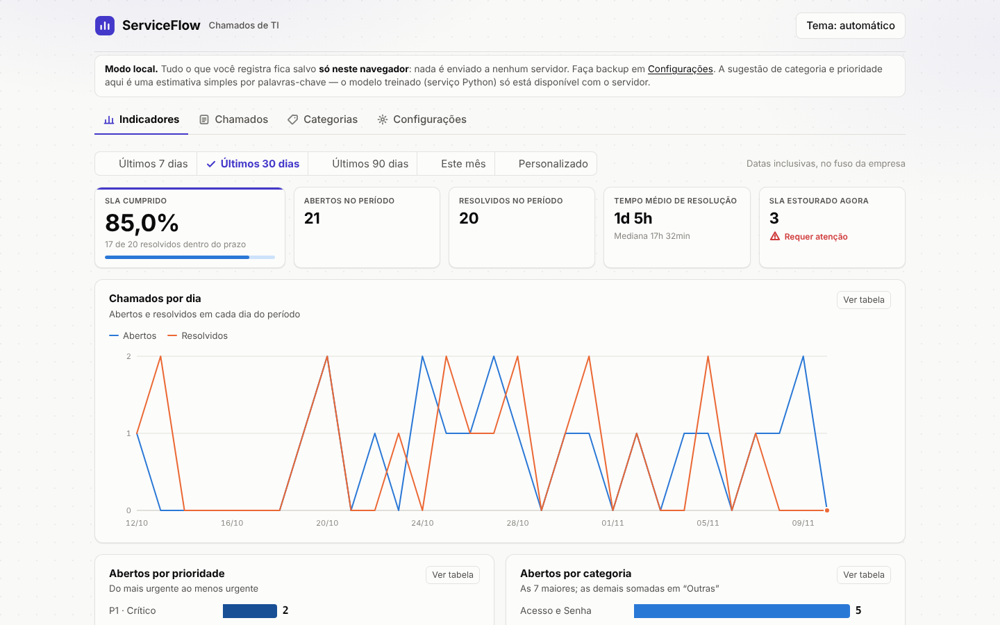
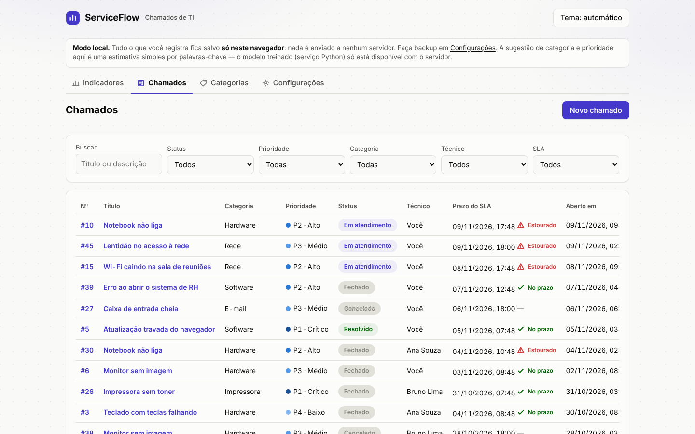
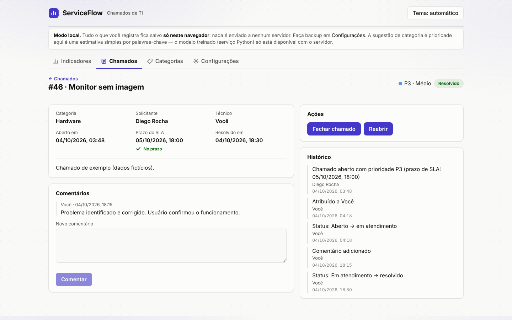

# Estudo de caso — ServiceFlow

Sistema de gestão de chamados de TI (ITSM) com controle de SLA, construído em etapas para aprender Java e Spring Boot a partir de um problema que conheço bem: o dia a dia do suporte técnico.

## O problema

Em uma central de suporte, três perguntas aparecem todo dia:

1. Qual chamado eu atendo primeiro?
2. Este chamado vai estourar o prazo?
3. Como está o desempenho da equipe no mês?

Ferramentas de mercado respondem isso, mas eu queria entender como as regras funcionam por dentro. O ServiceFlow implementa essas regras do zero: prioridade, prazo de SLA, fluxo de status, permissões e indicadores.

## O que o sistema faz

- Abre chamados e calcula o prazo de SLA automaticamente pela prioridade.
- Controla quem pode fazer o quê com três papéis: ADMIN, TÉCNICO e SOLICITANTE.
- Segue um fluxo de status definido: Aberto → Em atendimento → Resolvido → Fechado (ou Cancelado).
- Registra comentários e um histórico completo de cada chamado.
- Mostra indicadores: SLA cumprido, tempo médio e mediana de resolução (MTTR), volume por categoria e prioridade, desempenho por técnico.
- Sugere categoria e prioridade enquanto o usuário escreve, com um modelo em Python.

## Decisões técnicas

### SLA em horário comercial

Prioridades críticas (P1 e P2) contam em tempo corrido. As demais (P3 e P4) contam só o expediente: 08h às 18h, de segunda a sexta, sem feriados.

Exemplo: um chamado P3 aberto na sexta às 16h vence na segunda às 16h (2h na sexta + 8h na segunda).

O prazo é gravado na abertura do chamado. Assim, se o ADMIN mudar a regra depois, os chamados já abertos não mudam.

### Tempo como dependência

O relógio do sistema (`Clock`) é injetado nas classes. Nos testes, uso um relógio fixo. Isso deixa o cálculo de prazo testável de forma determinística, sem depender da hora em que o teste roda.

### Segurança

- Login com JWT de 15 minutos e refresh token de 7 dias.
- O refresh token é de uso único. Se um token já usado aparecer de novo, todas as sessões do usuário são encerradas, porque isso indica vazamento.
- O banco guarda só o hash SHA-256 do refresh token, e as senhas com BCrypt.
- Um solicitante que tenta abrir o chamado de outra pessoa recebe `404`, e não `403`. Assim a API não confirma que o chamado existe.

### Camadas e contratos

- Controllers só tratam HTTP. Regras de negócio ficam nos services.
- A API recebe e devolve DTOs (records). As entidades do banco nunca saem da API.
- O schema do banco é versionado com Flyway. O Hibernate só valida.
- O histórico é só de inserção e é gravado na mesma transação da ação.

### Indicadores calculados no banco

Os indicadores usam SQL nativo do PostgreSQL (`COUNT(*) FILTER`, `percentile_cont`, `generate_series`). O cálculo fica perto dos dados, sem trazer milhares de linhas para a aplicação.

### Sugestão automática com degradação elegante

Um microsserviço em Python (FastAPI + scikit-learn) sugere categoria e prioridade. Se ele estiver fora do ar, o chamado continua sendo aberto normalmente. A sugestão é uma ajuda, não um requisito.

## Testes

- **Unitários** (JUnit 5 + Mockito): regras dos services, cálculo de SLA, calendário comercial, máquina de estados, JWT e rotação de refresh token.
- **Integração** (MockMvc + Testcontainers): a aplicação completa contra um PostgreSQL real e temporário. Cobre o ciclo de vida do chamado, autorização, visibilidade, validação e troca de senha.

## Versão local no navegador

O front-end também roda sem servidor. Um "motor" em TypeScript responde no lugar da API, com as mesmas regras do backend, e guarda os dados só no navegador de quem usa. Isso permite publicar o projeto como site estático, sem precisar de Java nem banco.

| Lista de chamados | Detalhe do chamado |
|---|---|
|  |  |

*As imagens usam dados fictícios gerados para demonstração.*

## Stack

Java 21 · Spring Boot 3.3 · Spring Security · PostgreSQL 16 · Flyway · Docker · JUnit 5 · Testcontainers · React 19 · TypeScript · Python (FastAPI, scikit-learn)

## Próximos passos

- Publicar automaticamente o modelo de sugestão retreinado.
- Avaliar o uso de um LLM para sugestões mais precisas.
